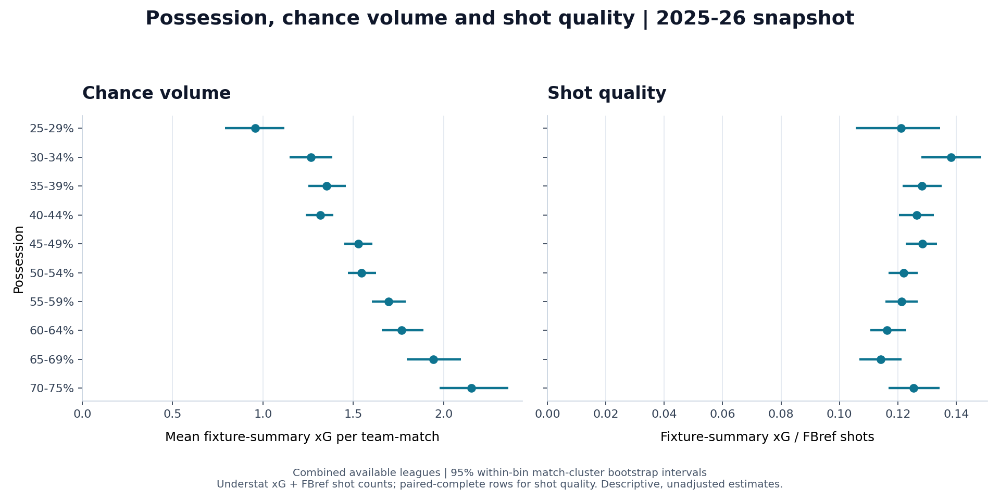
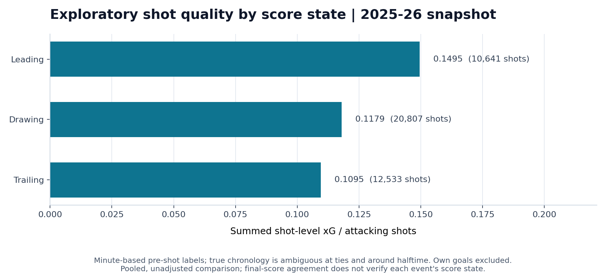

# Football Possession & xG Analysis

A reproducible football analytics case study by [Ata Yunus Ortak](https://github.com/ata-yunus-ortak). It examines how possession relates to chance volume and shot quality, then reconstructs match scores to compare attacking metrics when teams lead, draw or trail.

The project contains offline analysis code, visualisations, machine-readable results, validation reports and regression tests. The included case study uses a locally held **2025–26 season snapshot**; provider inputs are kept out of Git. A small synthetic example runs after a fresh clone without downloads or accounts.



## Case study in a minute

**Question:** does having more of the ball mean creating more chances, better chances, or both?

**Approach:** reconcile FBref possession/shot counts with Understat xG, keep incomplete observations out of ratio denominators, and replay shot events against final scores. Publish exclusions alongside the estimates, with a synthetic demo that anyone can run offline.

**Finding:** combined mean xG is **0.956** in the 25–29% possession bin and **2.154** in the 70–75% bin. Chance volume generally increases across the bins, while shot quality does not increase consistently. This snapshot supports separating chance volume from chance quality when evaluating possession.

**Interpretation:** these are descriptive associations. Team strength, opponents, tactics and score state can influence both possession and chance creation. The figures do not establish a causal effect of possession or prove statistical independence.

Engineering focus: source-name normalization, one-to-one joins, paired-complete ratios, own-goal-aware score replay, fixture-level exclusions, match-cluster bootstrap intervals, reproducible reports and offline CI. This project uses provider xG; it does not train a new xG model.

## Verified scope

| Analysis | Included data |
| --- | --- |
| Possession and xG | 2,744 matched team-match observations across **four** leagues; Serie A possession data is unavailable |
| Possession analysis range | 2,692 observations with 25–75% possession, including 75% |
| Shot quality | 2,592 observations with both xG and shot counts; incomplete pairs excluded |
| Score-state analysis | **1,750 score-verified matches**, five leagues, 44,111 events |
| Attacking-shot metrics | 43,981 shots; 130 own-goal events update the score but are excluded from shot-quality/conversion denominators |

One fixture has no shot records. A different fixture is excluded from score-state analysis because event replay disagrees with its match score. No attempt was made to silently remove possibly repeated shots. Full exclusions and source-file checksums are in [validation_report.json](results/validation_report.json).

**What verification establishes:** final-score agreement and source-matching checks, with explicit gaps. It does not verify each event's true chronology or guarantee equality between fixture xG and summed shot xG.

## Current descriptive results

The paired-complete possession sample has an overall **0.1234 xG per shot**. This metric combines Understat xG with FBref shot counts; provider definitions may differ. Each bin uses its own complete observations, so sample sizes differ between chance-volume and shot-quality estimates. See the [aggregate possession table](results/possession_summary.csv) for estimates, intervals and counts.

In the **exploratory, minute-replayed score-state sample**, summed shot-level xG per attacking shot is approximately **0.1495 when leading**, **0.1179 when drawing**, and **0.1095 when trailing**. These pooled comparisons are not adjusted for team strength, opponent, match minute or other context.



The state is assigned **before the shot**; a goal cannot move its own shot into the leading category. **Intermediate states remain uncertain:** the source has integer minutes but no period or precise clock. Numeric shot-ID order, which is not verified chronology, has decreasing minutes in 258 included fixtures. A sensitivity replay in that alternative order changes 378 event labels across 287 fixtures. The published charts retain stable minute sorting; these checks expose uncertainty rather than establish a replacement ordering. See [event-order diagnostics](results/event_order_diagnostics.csv).

The higher pooled quality while leading could reflect selection and match context. It is not evidence that taking the lead causes better chances. See the [aggregate score-state table](results/game_state_summary.csv).

**Two xG quantities:** possession outputs use fixture-summary xG; state outputs sum individual shot xG. In 1,135 included fixtures, at least one team's totals differ by more than 0.001. Overall the shot sum is 5,417.1062 versus 5,326.3136 in fixture summaries, about **1.7% higher**. Aggregate definitions may differ; the source grouping rule is unverified. The public [xG diagnostics](results/xg_reconciliation.csv) contain fixture identifiers, derived differences and tolerance flags; detailed source-value comparisons stay local. Discrepancies do not trigger speculative event deletion.

Possession plots include 95% within-bin match-cluster bootstrap intervals. Both teams from the same fixture stay in one resampling cluster within a bin. These intervals describe sampling variation under the chosen scheme; they are not between-bin hypothesis tests.

**Exposure-based xG/90 remains approximate.** Real match end times are not present in the supplied event files. Estimated end times are explicitly labelled; a verified duration CSV can replace them. Minute-level event ordering is another limitation.

## Quick start

Python 3.10 or 3.12. The offline requirements were pinned to the versions used for preparation.

`requirements-lock.txt` also records the complete dependency set from the clean Windows/Python 3.10 validation environment. It can be used instead of `requirements.txt` to reproduce that dependency snapshot.

```powershell
python -m venv .venv
.\.venv\Scripts\python.exe -m pip install -r requirements.txt
.\.venv\Scripts\python.exe -m unittest discover -s tests -v
.\.venv\Scripts\python.exe run_analysis.py --data-dir examples/synthetic --output-dir demo-results --synthetic
```

On Linux/macOS use `.venv/bin/python` instead of `.\.venv\Scripts\python.exe`.

The synthetic example is explicitly invented data. Its figures exercise the pipeline and are **not** case-study findings.

### Run the real case study locally

When the locally held inputs are already in `futbol_xg/data/`:

```powershell
.\.venv\Scripts\python.exe run_analysis.py
```

Alternatively, point directly at a directory containing the source CSVs:

```powershell
.\.venv\Scripts\python.exe run_analysis.py --data-dir "PATH_TO_LOCAL_DATA"
```

To copy inputs from an existing `Futbol Analiz` project into this checkout, before any inputs have been imported:

```powershell
.\.venv\Scripts\python.exe import_inputs.py --source "PATH_TO_EXISTING_PROJECT"
```

No network, browser, API key, `soccerdata` package or Windows DLL is needed for analysis. See [DATA_SOURCES.md](DATA_SOURCES.md) for schemas, source attribution and the distinction between local inputs and published aggregates.

### Provide match durations

```powershell
.\.venv\Scripts\python.exe run_analysis.py --durations "match_durations.csv"
```

Duration columns: `league,season,game_id,end_minute`. Use the same elapsed-match-minute clock as the shot events. Missing duration rows remain explicitly estimated. An end time earlier than a recorded event is rejected. A provided file is a user-supplied duration source, not independent verification by this code.

## Outputs

`run_analysis.py` always rebuilds the score-state tables; stale cached labels are not reused. Main publication artifacts go to `results/`:

- Two compact overview charts used above, derived from the same aggregate tables.
- Three possession plots: chance volume, shot quality and goals-minus-xG.
- Three score-state plots: shot quality, finishing conversion and approximate xG/90.
- `possession_summary.csv` and `game_state_summary.csv`.
- `match_validation.csv` and `validation_report.json`.
- `xg_reconciliation.csv` and `event_order_diagnostics.csv`: derived audit tables for all score-verified fixtures.

Generated event, exposure and detailed xG reconciliation tables remain next to the ignored local inputs. `--output-dir` selects another figure/report directory; `--bootstrap` controls the number of resamples (default 1,000, seed 2026).

League-level detail: [chance volume](results/possession_xg_hacmi.png), [shot quality](results/possession_sut_kalitesi.png), [finishing residual](results/possession_bitiris_verimliligi.png), [score-state quality](results/durum_sut_kalitesi.png), [conversion](results/durum_donusum.png) and [approximate xG/90](results/durum_xg_90.png).

## Project layout

```text
run_analysis.py              Offline entry point
import_inputs.py             Explicit local input import
futbol_xg/analysis_core.py    Validation, matching, score replay and statistics
futbol_xg/analiz_*.py         Plot generation
futbol_xg/overview.py         Compact charts from the aggregate results
futbol_xg/data/              Local provider inputs and derived event tables (ignored)
futbol/                     Earlier exploratory possession/goals scripts
examples/synthetic/         Invented data for a fresh-clone demo
results/                    Case-study plots, aggregate results and audit reports
tests/                      Regression tests with synthetic fixtures
```

The earlier `futbol/` CSVs lack fixture identifiers and may include play-offs. Their exploratory plots are separated under `results/legacy/` and are not used in the main xG analysis. Their input CSVs also remain local-only.

The optional source collectors (`veri_cek.py`, `fbref_cache_parse.py`, `serie_a_tamamla.py`) are retained for provenance. They are not required by the offline workflow, and live provider access was not revalidated. Optional dependencies are listed in `requirements-data.txt`. The earlier machine-specific DLL workaround and browser scraper are not bundled.

## Quality checks and corrections

- One-to-one source matching, goal agreement and duplicate event/key checks.
- Finite, non-negative metric inputs and whole-number goals/shot counts.
- Own goals credited to the opponent; scores checked against fixture totals.
- Fixture/event xG reconciliation and an explicitly unverified ordering sensitivity; neither edits the retained events.
- Inconsistent matches excluded in full and listed in reports; missing events remain visible.
- Missing shot counts excluded only from metrics that need them.
- The final possession endpoint is included; coverage is reported honestly.
- Zero-shot states retain their exposure minutes; season is part of grouping keys.
- Shared plot scales, visible sample sizes and no truncated bar baselines.

See [METHODS.md](METHODS.md) for definitions and [CHANGELOG.md](CHANGELOG.md) for the preparation changes. CI runs synthetic regression tests and a demo on Python 3.10/3.12; it does not fetch provider data.

## Attribution and permissions

Sources: [FBref](https://fbref.com/) and [Understat](https://understat.com/). Source data and provider xG models are not created by this project. This project does not train a new xG model.

Raw third-party tables are not included in the public upload package. No general open-source licence is assigned to the project at this stage; repository visibility does not grant a separate reuse licence. Data-source rights remain with their respective owners. See [DATA_SOURCES.md](DATA_SOURCES.md).

Companion project: [Football Video Analysis](https://github.com/ata-yunus-ortak/football-video-analysis), a separate computer-vision workflow for football footage.

## Curated upload package

Run `python build_upload.py` to create `football-possession-xg-analysis-github.zip` beside this directory, with a SHA-256 checksum. It includes code, documentation, tests, synthetic inputs and case-study results, while excluding provider inputs, generated demo tables, virtual environments and binaries.
